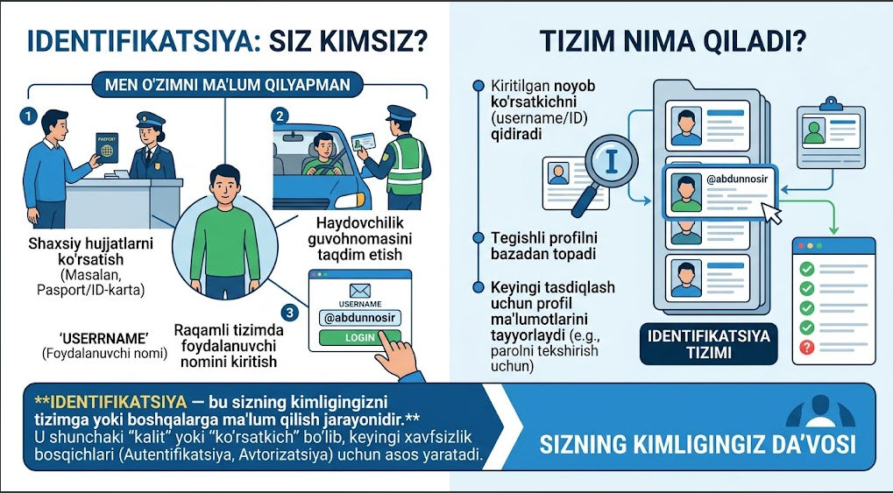
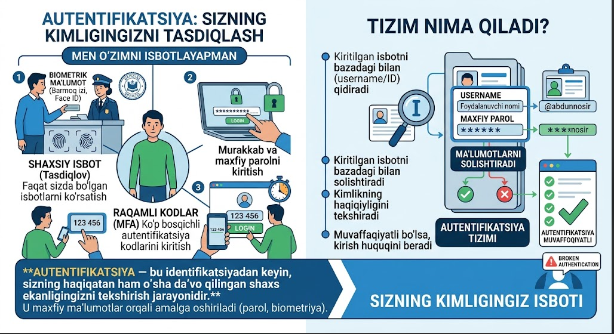
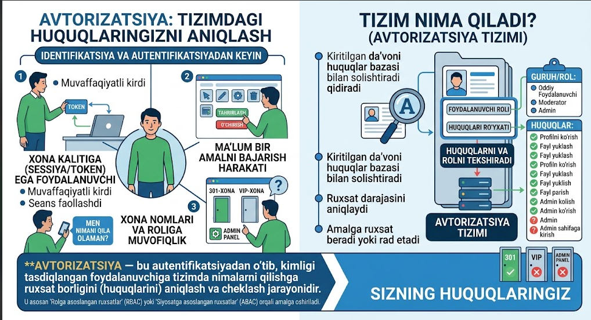
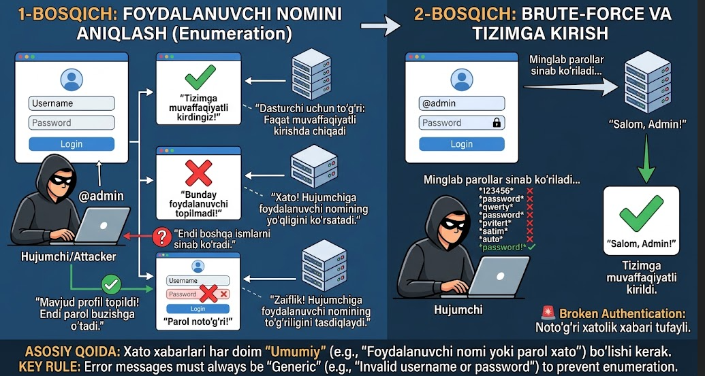
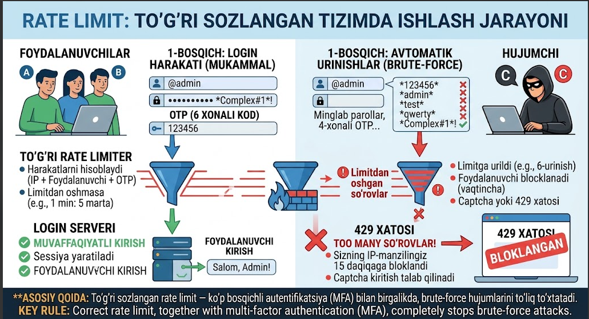
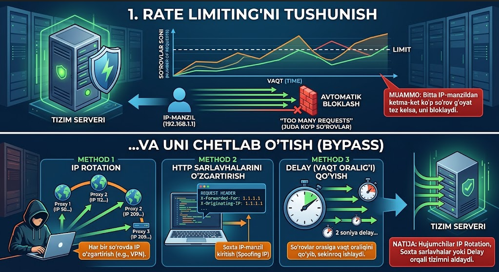
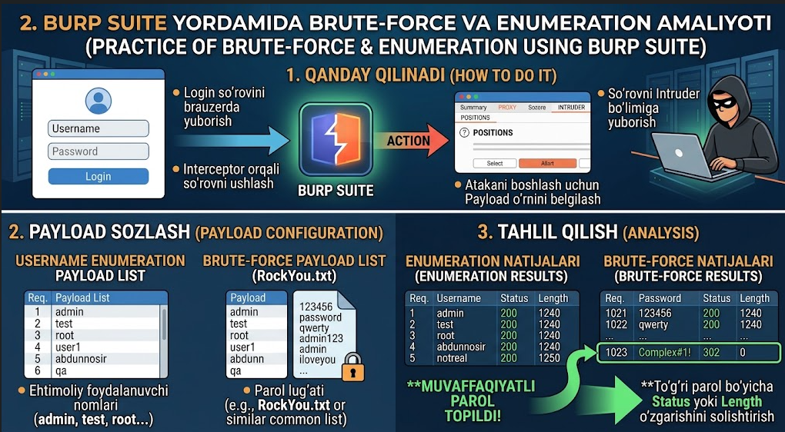
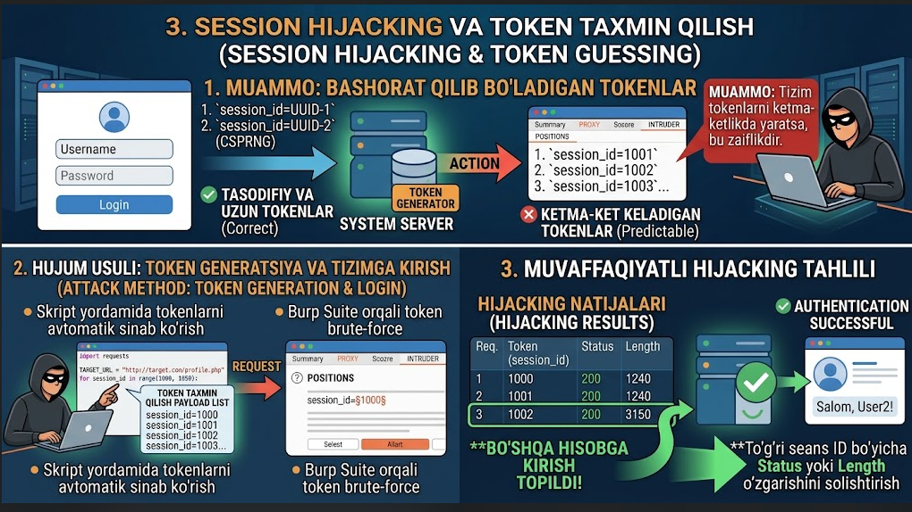

# Broken Authentication

Bu zaiflikni tushunishdan avval **Identification**, **Authentication** va **Authorization** nima ekanini tushunib olish kerak — chunki tizim normal holatda nima qilishini bilsak, keyin u qanday holatda buzilishini ham tushunamiz.

## 1. Identification — Siz kimsiz?

Tizimga "men shu foydalanuvchiman" deb o'zingizni ma'lum qilish jarayoni. Masalan, aeroportda xodimga "men Abdunnosirman" deb aytishingiz va pasportingizni berishingiz — bu identifikatsiya. Tizimda esa bu — username, login, telefon raqami yoki email kiritish bosqichi.

## 2. Authentication — Kimligingizni tasdiqlash

Siz bergan ma'lumotni haqiqiysi bilan solishtirish jarayoni. Aeroport misolida — xodim pasport raqamini bazadan tekshiradi, rasmingizni yuzingiz bilan solishtiradi. Tizim darajasida — kiritgan username va parolingiz bazada saqlangan username va parolga teng ekanligi tekshiriladi.

## 3. Authorization — Nima qila olasiz?

Authentication'dan keyingi bosqich. Kimligingiz tasdiqlangandan keyin, sizda qanday huquqlar borligi tekshiriladi. Aeroport misolida — oddiy yo'lovchi faqat samolyotga chiqish huquqiga ega, lekin uchuvchi kabina huquqiga ega. Tizimda ham xuddi shunday — siz oddiy foydalanuvchimisiz yoki administratormisiz, shunga qarab imkoniyatlaringiz cheklanadi.

## Broken Authentication nima

Bu — Authentication bo'limi zaif sozlangani uchun, hujumchi boshqa foydalanuvchining parolini yoki emailini bilmasdan turib, uning nomidan ish bajarishi yoki narsalarini o'g'irlashi mumkin bo'lgan zaiflik. Buning uchun hujumchi parolni yoki userni taxmin qilib topishi, yoki sessiyani o'g'irlashi mumkin.

## Autentifikatsiya omillari (faktorlari)

Autentifikatsiya foydalanuvchining uchta asosiy faktoriga tayanadi:

- **Nimani bilasiz** (Something you know): Parol, PIN-kod, maxfiy savol javobi
- **Nimaga egasiz** (Something you have): Telefon (SMS/Authenticator), YubiKey, email xabarnomasi
- **Kimligingiz** (Something you are): Barmoq izi, Face ID, ko'z to'ri (Iris), ovoz

Shu faktorlar soniga qarab autentifikatsiya turlarga bo'linadi:

| Tur | Ta'rifi | Xavfsizlik darajasi |
|---|---|---|
| **SFA** (Single-Factor) | Faqat bitta faktor (masalan, faqat Username + Password) | Past — brute-force yoki parol o'g'irlash orqali oson buziladi |
| **2FA** (Two-Factor) | Ikkita har xil faktor (Parol + SMS kod yoki Parol + Barmoq izi) | O'rta-yuqori |
| **MFA** (Multi-Factor) | Ikki yoki undan ortiq turli faktor | Hozirgi kunda eng xavfsiz usullardan biri |

## Dasturchilar yo'l qo'yadigan xatoliklar

### 1. Aniqlik kirituvchi xato xabarlari (Username Enumeration)

**Xatolik:** Login vaqtida "Bunday foydalanuvchi topilmadi" va "Parol noto'g'ri" deb alohida-alohida xabar chiqarish.

**Oqibati:** Hujumchi tizimda qaysi username'lar mavjudligini osonlikcha aniqlab oladi va keyin o'sha profilga hujum qiladi.

**Tuzatuv:** Username xato bo'ladimi, parol xato bo'ladimi — har doim "Username yoki parol xato" deb umumiy javob qaytarish kerak. Eng muhim nuqta: ikkala xabar bir-biridan hatto bitta nuqta bilan ham farq qilmasligi shart.

### 2. Rate Limiting yo'qligi

**Xatolik:** Biror IP-manzil yoki foydalanuvchi nomidan qisqa vaqt ichida minglab marta noto'g'ri parol kiritilsa ham, tizim buni bloklamaydi.

**Oqibati:** Hujumchilar avtomatlashtirilgan vositalar (Burp Suite Intruder va boshqalar) yordamida Brute-Force hujumlarini bemalol amalga oshira oladi.

To'g'ri sozlangan rate limit, ko'p bosqichli autentifikatsiya (MFA) bilan birgalikda, brute-force hujumlarini to'liq to'xtatadi:

### 3. Bashorat qilib bo'ladigan sessiya ID'lari (Predictable Session IDs)

**Xatolik:** Foydalanuvchi tizimga kirganda beriladigan seans tokeni tartibli raqamlardan (1, 2, 3...) iborat bo'lishi.

**Oqibati:** Hujumchi o'zining seans raqamini bittaga o'zgartirib (`session_id=15` o'rniga `16`), boshqa birovning profiliga parolsiz kirib ketishi mumkin (IDOR / Session Hijacking).

### 4. Zaif parol siyosati

**Xatolik:** Foydalanuvchilarga `123456`, `qwerty` yoki juda qisqa parollarni qo'yishga ruxsat berish.

**Oqibati:** Bunday parollarni ommaviy lug'atlar (Dictionary attack) yordamida bir soniyada topib olish juda oson.

### 5. Seansni to'g'ri tugatmaslik (Insecure Logout)

**Xatolik:** Foydalanuvchi "Chiqish" tugmasini bosganda, brauzerdagi cookie o'chishi mumkin, lekin server tomonida o'sha seans yaroqsiz holatga keltirilmaydi (faol qolaveradi).

**Oqibati:** Agar hujumchi ushbu tokenni oldinroq saqlab qolgan bo'lsa, foydalanuvchi tizimdan chiqqanidan keyin ham uning nomidan foydalanishda davom etishi mumkin.

### 6. Parollarni ochiq yoki zaif shifrlashda saqlash

**Xatolik:** Parollarni ma'lumotlar bazasida oddiy matn (plaintext) yoki eskirgan, oson buziladigan usullarda (masalan, shifrlanmagan MD5) saqlash.

**Oqibati:** Agar ma'lumotlar bazasi sizib chiqsa (SQL injection yoki boshqa yo'l bilan), barcha foydalanuvchilarning parollari darhol qo'lga kiritiladi.

## Hujumchilar uchun amaliy usullar

### 1. Rate Limiting'ni chetlab o'tish (Bypass)

Ko'pchilik tizimlar bitta IP-manzildan ketma-ket ko'p so'rov kelsa, uni bloklaydi. Hujumchilar buni quyidagicha chetlab o'tadi:

- **IP Rotation** — har bir so'rovda boshqa proxy yoki VPN orqali IP o'zgartirish
- **HTTP sarlavhalarini o'zgartirish** — `X-Forwarded-For: 1.1.1.1`, `X-Originating-IP` kabi sarlavhalar orqali tizimni aldash
- **Delay qo'yish** — so'rovlar orasiga vaqt oralig'i qo'yib, sekinroq brute-force qilish

### 2. Burp Suite yordamida Brute-Force va Enumeration

1. Login sahifasiga yuborilgan so'rov Burp Suite Interceptor orqali ushlab olinadi va Intruder bo'limiga yuboriladi
2. Username uchun bir nechta ehtimoliy nomlar (`admin`, `test`, `root`) va parol uchun keng tarqalgan lug'at (RockYou.txt) tanlanadi
3. Javob qaytishidagi Response Length (javob hajmi) yoki Status kodlarini taqqoslash orqali to'g'ri parol topib olinadi

### 3. Session Hijacking va token taxmin qilish

Agar tizim Session ID yoki tokenlarni tasodifiy emas, balki ketma-ketlikda yaratsa (`id=1001`, `id=1002`), skript yordamida boshqa foydalanuvchilarning tokenlarini generatsiya qilib ko'rish mumkin. Agar server xato tekshirsa, boshqa birovning akkauntiga kirib ketish mumkin.

### 4. Parametrlarni soxtalashtirish (IDOR & Broken Auth uyg'unligi)

Ba'zi tizimlar foydalanuvchi tizimga kirgach, uning kimligini URL yoki Cookie ichidagi `user_id` orqali aniqlaydi. O'z kabinetingizda turib, so'rovdagi `user_id=5` raqamini `user_id=1` ga o'zgartirib yuborsangiz, agar avtorizatsiya yaxshi ishlamasa, boshqa foydalanuvchining ma'lumotlarini ko'rishingiz mumkin.

### 5. Parolni tiklash (Password Reset) mexanizmini buzish

Parolni tiklash uchun yuboriladigan 4 xonali kodlar yoki tokenlar cheksiz marta kiritishga ruxsat berishi mumkin. Parolni tiklash so'rovini yuborib, olingan 4 xonali kodni Intruder yordamida `0000` dan `9999` gacha tezkorlik bilan sinab chiqish orqali istalgan foydalanuvchi parolini o'zgartirib olish mumkin.
