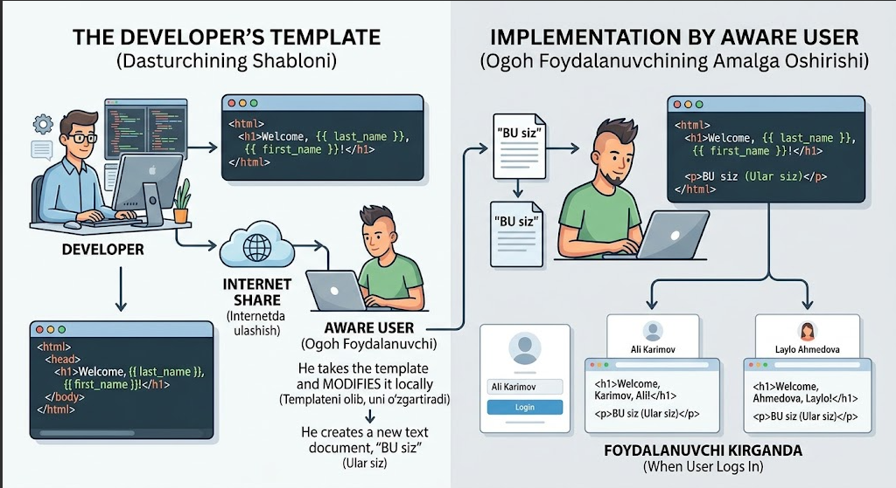
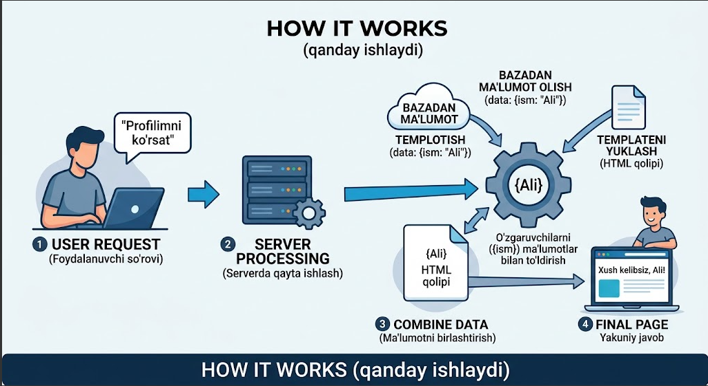
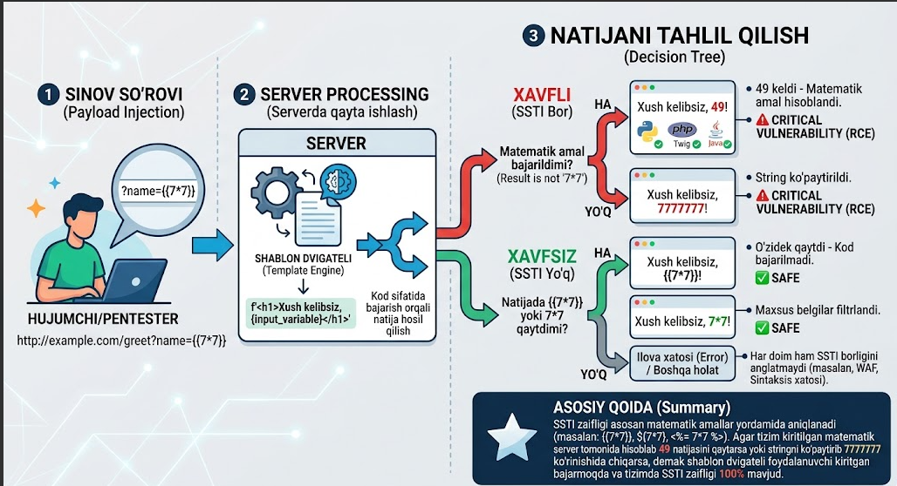

# Server Side Template Injection (SSTI)

Bu zaiflikni tushunishdan oldin, avval **template** nima ekanini tushunib olish kerak. Template — bu oldindan tayyorlab qo'yilgan HTML kod bo'lib, o'zingizga kerak bo'lgan joyda o'sha kodni qayta-qayta ishlatish mumkin.

Masalan: tasavvur qiling, sizda veb-sayt bor va foydalanuvchi o'z akkauntiga kirganida "Xush kelibsiz, **{foydalanuvchi ismi}**" deb chiqarmoqchisiz. Har safar bu uchun qo'lda kod yozib o'tirmaysiz — tayyor shablonni (template) olib, shu yerga joylaysiz. Aynan shu narsa **template** deb ataladi.

[](pictures/01-template-concept.png)

## SSTI nima

SSTI zaifligi xuddi shu shablon (template) ichida foydalanuvchi kiritmasi oddiy matn emas, balki shablonning o'zidagi **kod** deb qabul qilinishidan kelib chiqadi. Bu dasturchi tomonidan shablonga noto'g'ri o'zgartirish kiritilganda yuzaga keladi.

**Asl (xavfsiz) kod (Python):**

```python
name = input()
# Shablon o'zgarmaydi, 'name' esa shunchaki ma'lumot sifatida o'tadi
return render_template_string('<h1>Xush kelibsiz, {{ name }}</h1>', name=name)
```

**Zaif bo'lib qolgan kod:**

```python
name = input()  # yoki request.args.get('name')
template = f'<h1>Xush kelibsiz, {name}</h1>'  # Input shablon kodiga f-string bilan ulangan
return render_template_string(template)
```

Yuqorida ko'rganingizdek, foydalanuvchi kiritgan ma'lumot shablon kodining bir qismi sifatida o'qib yuborilmoqda. Foydalanuvchi to'g'ri ism-familiya kiritsa — hammasi yaxshi ishlaydi. Lekin o'rniga reverse shell bog'lovchi kod yozsa, tizimga hech qanday login-parolsiz kirib ketishi mumkin bo'ladi.

[](pictures/02-how-it-works.png)

## Hujumchi buni qanday tekshiradi

SSTI zaifligi asosan **matematik amallar** bilan tekshiriladi:

```
{{7*7}}
```

Agar tizim bu yerga `49` deb chiqarsa (yoki `7777777` kabi boshqacha, lekin har holda matematik amal bajarilgan natija bersa) — zaiflik mavjud. Agar u shunchaki `{{7*7}}` deb o'zini qaytarsa yoki xatolik bersa — SSTI yo'q (yoki hozircha aniqlanmadi).

Har xil template dvigatellari uchun tekshirish sintaksisi ham har xil:

```
{{7*7}}        → Jinja2, Twig
${7*7}         → FreeMarker, Velocity
<%= 7*7 %>     → ERB (Ruby)
{7*7}          → Smarty
```

[](pictures/03-testing-decision-tree.png)

## Dasturchi yo'l qo'yadigan xatoliklar

### 1. User Input'ni shablon kodi bilan birlashtirish (Concatenation)

Dasturchining eng katta va asosiy xatosi — foydalanuvchi yuborgan ma'lumotni shablon fayli yoki satri bilan to'g'ridan-to'g'ri ulashi (`+`, f-string, `.format()` yoki string interpolation orqali).

❌ Xavfli:
```python
# Python / Flask
name = request.args.get('name')
template = f'<h1>Xush kelibsiz, {name}!</h1>'  # Input shablon kodiga aylanib qoladi
return render_template_string(template)
```

### 2. Dynamic Template Creation (Dinamik shablon yaratish)

Shablon faylini statik holda saqlash o'rniga, har bir HTTP so'rov kelganda yangi shablon matnini kod ichida dinamik ravishda shakllantirib, uni `render_template_string()` kabi funksiyalarga uzatish. Dasturchi tayyor HTML shablon faylidan (`index.html`) foydalanmay, string ko'rinishidagi shablonlarni to'g'ridan-to'g'ri render qilsa — xavf ortadi.

### 3. Input Sanitization (Filtrlash) yo'qligi

Dasturchi shablon dvigateli tushunadigan maxsus belgilarni (`{`, `}`, `%`, `$`, `<`, `>`, `=`) kirish maydonida filtrламайди yoki escape qilmaydi.

## Asosiy qoida (xulosa)

SSTI zaifligi asosan matematik amallar yordamida aniqlanadi (masalan `{{7*7}}`, `${7*7}`, `<%= 7*7 %>`). Agar tizim kiritilgan matematik amalni hisoblab, `49` natijasini yoki stringni ko'paytirib (`7777777`) qaytarsa — demak shablon dvigateli foydalanuvchi kiritgan narsani kod sifatida bajarmoqda va tizimda SSTI zaifligi 100% mavjud.

## SSTI zaifligi aniqlangan real kompaniyalar

### 1. Glovo (Yetkazib berish xizmati)

Foydalanuvchi ro'yxatdan o'tayotganda **First Name** (Ism) maydoniga `{{7*7}}` payloadini kiritgan. Tizim yangi foydalanuvchiga "Welcome" email yuborayotganda shu ismni shablon ichiga to'g'ridan-to'g'ri joylashtirgani uchun, email generator serverida SSTI zaifligi ishga tushgan — email mavzusi "49, welcome to Glovo!" bo'lib chiqqan.

- Platforma: HackerOne Bug Bounty
- Hisobot: [hackerone.com/reports/1104349](https://hackerone.com/reports/1104349)

### 2. Unikrn (Gaming platformasi, Smarty Template Engine)

Foydalanuvchi profilidagi ism, familiya va nickname maydonlariga Smarty shablon kodi (`{7*7}`) kiritilib, boshqa foydalanuvchiga taklifnoma (invite) yuborilganda, shablon kodi server tomonidan bajarilib ketgan va `file_get_contents()` orqali `/etc/passwd` fayli sizdirilgan.

- Platforma: HackerOne Bug Bounty
- Hisobot: [hackerone.com/reports/164224](https://hackerone.com/reports/164224)

### 3. Uber (Flask / Jinja2 Template Injection → RCE)

Foydalanuvchi profil ismini `{{ '7'*7 }}` qiymatiga o'zgartirgan va "Your Uber account information has been updated" sarlavhali email kelgan, xabar matnida ism `'7777777'` bo'lib chiqqan — bu Flask'ning Jinja2 shablon dvigateli orqali SSTI mavjudligini tasdiqlagan. Zaiflik keyinchalik to'liq Remote Code Execution (RCE) darajasiga olib borilgan.

- Mukofot: $10,000
- Platforma: HackerOne Bug Bounty
- Hisobot: [hackerone.com/reports/125980](https://hackerone.com/reports/125980)
